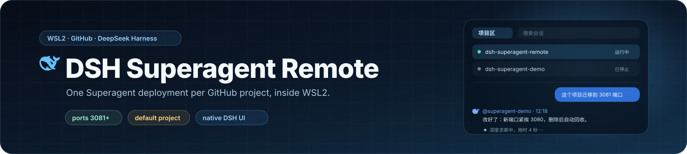
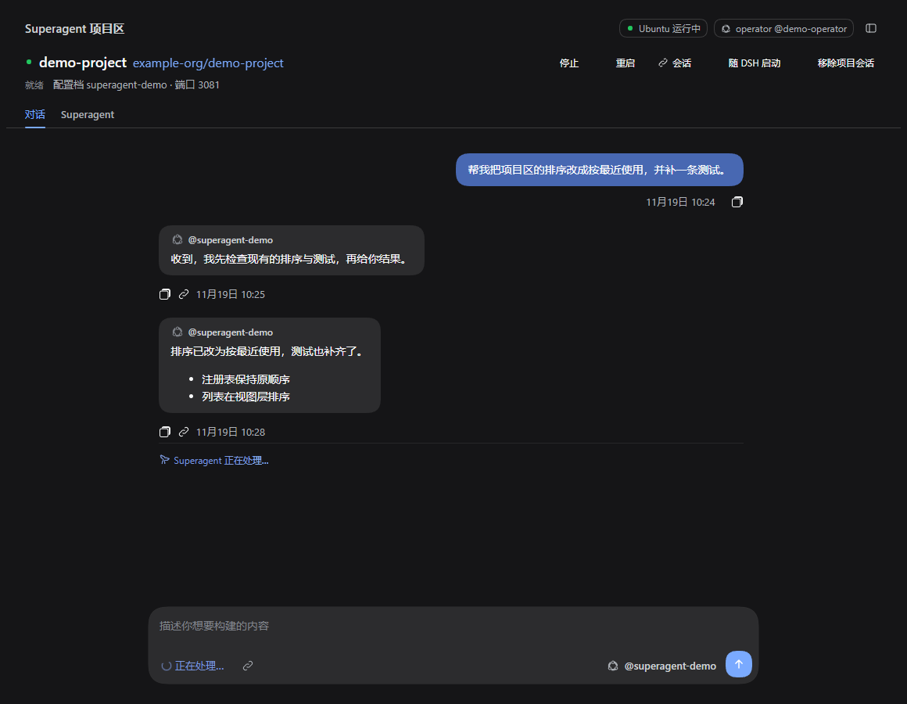

<h1 align="center">DSH Superagent Remote</h1>
<p align="center"></p>

<p align="center">
  <strong>English</strong>
  &nbsp;·&nbsp;
  <a href="./README.zh-CN.md">简体中文</a>
</p>

**DSH Superagent Remote** is a Windows-side [DeepSeek Harness](https://github.com/deepseek-ai/dsh) plugin that runs and supervises one [dsh-superagent](https://github.com/deepseek-ai/dsh-superagent-prototype) deployment per GitHub repository inside WSL2. Each project gets a DSH-native conversation backed by a GitHub issue thread, a project pane shaped like the harness workspace sidebar, and the deployment's own Superagent panel behind a reverse proxy — so the settings a person edits are the settings the WSL deployment runs.

- Host half (`src/`): the workspace registry, WSL2 lifecycle, per-workspace provisioning, the GitHub conversation, and the trust-fenced `/superagent-remote` route.
- Client half (`src/client/`): the workspace shell, the conversation window, the project pane, and the vendored `dt-column` panel with its API base pointed at one deployment.



The screenshot uses a demo workspace, repository, and accounts; no real account, deployment, or browser-extension overlay appears.

## Why

A dsh-superagent deployment is a whole DSH process with its own database, model routes, Executor and GitHub Source. Upstream one deployment serves one repository, so running several projects means several processes. This plugin makes that set manageable from the Windows DSH a person already uses: registry, ports, start/stop, the conversation transport, and the per-deployment panel all live in one place.

## Key properties

| Property | Value |
|---|---|
| Workspace model | One workspace = one GitHub repository + one DSH profile + one loopback port + one state directory |
| WSL lifecycle | The distribution starts lazily when the panel opens; closing the panel or the browser tab stops nothing. Only the whole DSH process stops the deployments and, when it owns the distribution, terminates WSL |
| Ports | New workspaces take the lowest free port at or above `portBase` (default 3081, next to DSH's 3080); removing a workspace stops its deployment and deletes its WSL profile and state directory, so its port is reused before a higher one |
| Default project | The panel restores the project that was open when it last closed, not the first one created |
| Conversation transport | One issue thread per workspace: every message is a comment mentioning the agent account; the deployment answers in the same thread |
| Reply latency | The send is optimistic (the message appears at once); an expected answer polls the thread every 1.5 s instead of the idle 3 s. GitHub comments are not a token stream, so a reply appears when the agent writes it |
| Reply presentation | Each answer keeps its own card with its writer above; the date sits in the action row below, with the copy and link buttons. An answer next to the message it follows has no reply bar |
| Reasoning presets | A newly created workspace defaults its main Session to Low effort and its Executor to Max effort, using the deployment's own default model |
| First paint | The last runtime and conversation snapshots are kept in `sessionStorage` and painted before the poll returns; the first start is the only load that waits on WSL |
| Runs | DeepSeek Harness web profile on Windows, Node `^22.19.0 \|\| >=24.0.0` |

## Installation

The plugin is private and installed from a checkout as a linked DSH bundle:

```powershell
pnpm install
pnpm check
dsh plugin --profile web add link:D:\Projects\dsh-plugins\dsh-superagent-remote
```

Then restart `dsh web`. The sidebar shows a **Superagent** entry.

Prerequisites are the ones in [docs/002-runbook.md](docs/002-runbook.md): WSL2 in mirrored networking mode, pnpm inside the distribution, `gh` signed in as the operator on Windows, and the agent's own `gh` wrapper inside the distribution. The managed checkout is the official Node/TypeScript dsh-superagent bundle. When it is missing, the plugin clones the upstream repository and runs `pnpm install` and `pnpm build` once.

## Usage

The panel has two views of the selected project:

| View | What it is |
|---|---|
| Chat | The DSH conversation window: content column, right-aligned person bubbles, an assistant card per answer with its date in the action row below, hover action rows, floating composer, the official animated whale while the deployment works |
| Superagent | The deployment's own six-tab panel (overview, sources, triggers, evaluation, execution, settings), proxied to that deployment |

The project pane opens from the header control. Rows are the harness workspace rows: pin, archive, search, view filter, and a row menu. Its selection is shared with the **Chat groups** tab in the harness right sidebar when the panel is not occupying the main column.

The workspace action row holds Start, Restart, **Session**, start-with-DSH, and Remove. **Session** reads the launch-token address from that deployment's log and opens its own DSH in a new tab, where the Executor session's Trajectory, detail panel and timing are the original controls. Removing a project stops its deployment, then deletes that deployment's profile, state directory, and session records inside WSL, and frees its port.

The first message opens the conversation issue in the repository; later messages are comments. Drafts are kept per workspace, and a reply that the deployment says will land in another thread is called out with a link to that thread.

## Configuration

Every key is optional and lives in the profile's `cordis.patch.yml`:

| Key | Default | Meaning |
|---|---|---|
| `distro` | `Ubuntu-22.04` | WSL distribution that hosts the deployments |
| `wslUser` | `root` | User inside the distribution that owns profiles and state |
| `checkout` | `/root/dsh-superagent` | dsh-superagent checkout inside the distribution; cloned and set up once when missing |
| `agentCli` | `/root/.local/bin/gh-agent` | Agent GitHub CLI wrapper used for a new workspace |
| `portBase` | `3081` | First port offered to a new workspace |
| `terminateWslOnExit` | `owned` | `owned` terminates the distribution only when this plugin started it; `always` and `never` override |
| `trustedHosts` | `[]` | Extra authorities allowed to call the plugin API, such as `192.168.1.5:3080` |
| `autoImport` | `true` | Register running deployments found in WSL on first open only; a removed project is not imported back |

## How it works

```text
browser (DSH web)                     Windows host                        WSL2
┌──────────────────┐  /superagent-remote/api/*  ┌────────────────┐
│ workspace shell  │ ─────────────────────────► │ host plugin    │
│ conversation     │  /superagent-remote/:id/   │ runtime        │ ──► dsh --profile <p>
│ vendored panel   │ ─── orchestrator/api/* ──► │ reverse proxy  │     127.0.0.1:<port>
└──────────────────┘                            └────────────────┘
```

- Every panel `GET state` and `PUT settings/...` goes through the proxy to the WSL deployment, so edits apply to that deployment directly.
- Conversation text comes from GitHub (`gh issue view`); the working/paused state comes from the deployment's management API.
- `/runtime/start` kicks off WSL boot and workspace starts in the background and answers the snapshot immediately, so the panel renders while provisioning continues.
- The client paints its cached snapshot first, then replaces it with the poll. Health, operator, and chat reads are already cached or parallelized on the host.

See [docs/001-architecture.md](docs/001-architecture.md) for modules, routes, and lifecycle details.

## Limits

- One deployment per repository, so several projects mean several DSH processes, each with its own memory and state directory.
- The conversation is a GitHub thread: messages are comments, not a token stream. A reply is visible after the agent writes it; the expected-answer poll is what shortens that wait.
- The deployment's own machine limits live in its profile `cordis.patch.yml`; the panel only displays them.
- The vendored panel keeps upstream type-checking off (`@ts-nocheck`); the plugin's own code stays strictly typed.
- Node 26 names its process `node-MainThread`, while the upstream service script matches only `node` and `dsh`. The plugin applies an idempotent edit that accepts any `node*` name before it starts a deployment; the edit is a no-op after upstream fixes the check.
- The reasoning preset applies when a workspace is provisioned. An existing workspace keeps the model selection its Sessions already recorded; change it in that deployment's panel.

## Development

```powershell
pnpm typecheck   # tsc --noEmit
pnpm test        # vitest
pnpm build       # tsdown -> lib/index.js + lib/client.js
pnpm check       # all three
```

Restart `dsh web` after changing the client bundle: the browser asks for a build revision and refuses a mismatched one, which otherwise shows as a blank panel.

## Docs

- [docs/001-architecture.md](docs/001-architecture.md) — concepts, data flow, modules, HTTP surface, lifecycle
- [docs/002-runbook.md](docs/002-runbook.md) — prerequisites, install, ports, troubleshooting
- [src/client/panel/PATCHES.md](src/client/panel/PATCHES.md) — vendored panel changes and upgrade steps

## License

MIT (`LICENSE`). `src/client/panel/vendor` is vendored from dsh-superagent under its MIT license (`vendor/LICENSE`).
