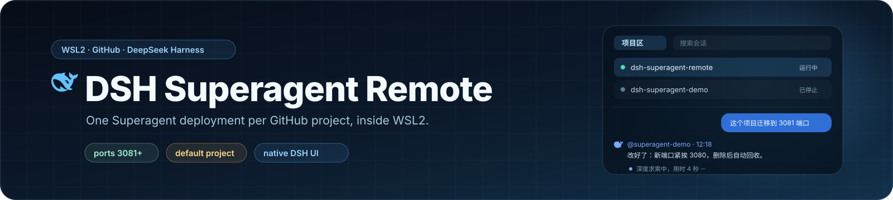
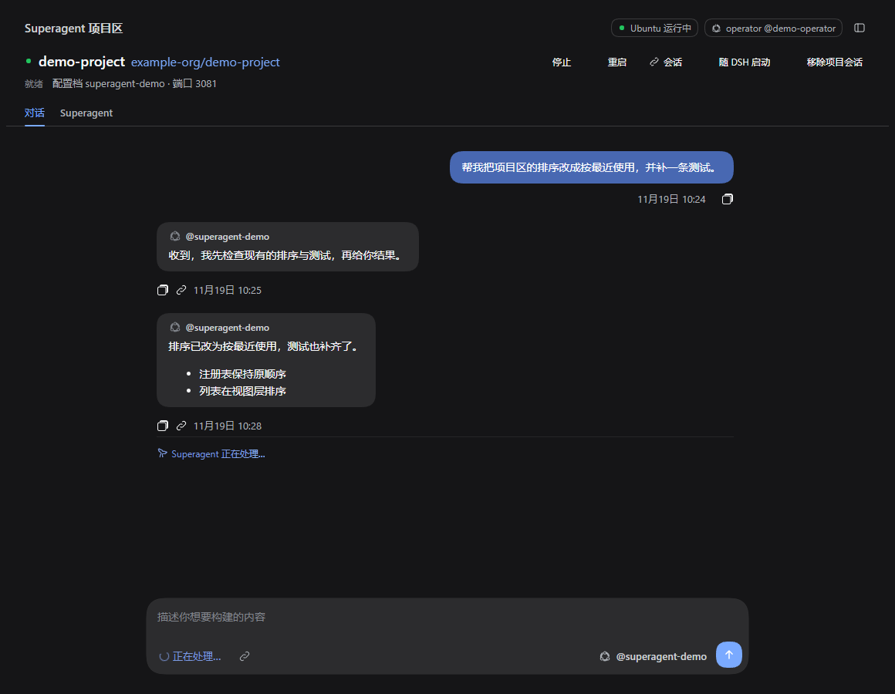

<h1 align="center">DSH Superagent Remote（Superagent 远程项目区）</h1>
<p align="center"></p>

<p align="center">
  <a href="./README.md">English</a>
  &nbsp;·&nbsp;
  <strong>简体中文</strong>
</p>

**DSH Superagent Remote** 是 Windows 侧的 [DeepSeek Harness](https://github.com/deepseek-ai/dsh) 插件：在 WSL2 里为每个 GitHub 仓库运行并托管一个 [dsh-superagent](https://github.com/deepseek-ai/dsh-superagent-prototype) 部署。每个项目有一条 DSH 原生的对话（底层是 GitHub issue 线程）、一栏照官方工作区侧栏做的项目区，以及反代到该部署自己的 Superagent 面板——面板里改的设置就是 WSL 部署实际运行的设置。

- Host 半区（`src/`）：工作区注册表、WSL2 生命周期、逐工作区供给、GitHub 对话，以及带信任围栏的 `/superagent-remote` 路由。
- Client 半区（`src/client/`）：工作区壳、对话窗口、项目区，以及 API base 指向单个部署的 vendored `dt-column` 面板。



截图使用演示工作区、仓库与账号；不包含真实账号、部署或浏览器插件悬浮窗。

## 为什么

一个 dsh-superagent 部署是一整套 DSH 进程，有自己的数据库、模型路由、执行器与 GitHub 来源。上游一个部署只服务一个仓库，所以多项目就是多个进程。这个插件把这组进程收进人已经在用的 Windows DSH 里：注册表、端口、启停、对话传输和逐部署面板都在一处。

## 关键性质

| 性质 | 值 |
|---|---|
| 工作区模型 | 一个工作区 = 一个 GitHub 仓库 + 一个 DSH 配置档 + 一个 loopback 端口 + 一个状态目录 |
| WSL 生命周期 | 打开面板时才启动发行版；关掉面板或浏览器标签不会停任何东西。只有整个 DSH 进程退出时才停部署，并在自己拉起发行版时终止 WSL |
| 端口 | 新工作区取 `portBase` 之上最低的空闲端口（默认 3081，紧挨 DSH 的 3080）；移除工作区会停掉部署并删除它在 WSL 中的配置档与状态目录，因此它的端口会先于更高端口被复用 |
| 默认项目 | 面板恢复上次关闭时打开的项目，而不是最先创建的项目 |
| 对话传输 | 每个工作区一条 issue 线程：每条消息都是提到智能体账号的评论，部署在同一线程里回答 |
| 回复延迟 | 发送是乐观的（消息立刻出现）；等待回答时每 1.5 秒读线程，空闲时 3 秒。GitHub 评论不是 token 流，回答在智能体写出它时出现 |
| 回复呈现 | 每条回答保留自己的卡片，作者在卡片上方；日期在下方动作行，与复制、链接按钮并排。紧挨它所回答消息的回答不带回复栏 |
| 推理强度预设 | 新建的工作区默认主 Session 为 Low、执行器为 Max，使用该部署自己的默认模型 |
| 首次绘制 | 最近一次 runtime 与对话快照存在 `sessionStorage`，先于轮询绘制；只有首次启动需要等 WSL |
| 运行环境 | Windows 上的 DeepSeek Harness web 配置档，Node `^22.19.0 \|\| >=24.0.0` |

## 安装

插件是私有的，以链接 bundle 的形式从检出安装：

```powershell
pnpm install
pnpm check
dsh plugin --profile web add link:D:\Projects\dsh-plugins\dsh-superagent-remote
```

然后重启 `dsh web`。侧边栏会出现 **Superagent** 入口。

前置条件见 [docs/002-runbook.md](docs/002-runbook.md)：WSL2 使用 mirrored 网络模式、发行版内有 pnpm、Windows 上的 `gh` 以 operator 登录、发行版内有智能体自己的 `gh` 包装脚本。托管的检出是官方的 Node/TypeScript dsh-superagent bundle；检出不存在时，插件会克隆上游并执行一次 `pnpm install` 与 `pnpm build`。

## 用法

面板有两个视图：

| 视图 | 是什么 |
|---|---|
| 对话 | DSH 会话窗口：内容列、右对齐的用户气泡、每条回答一张卡片且日期在下方动作行、悬停显现的动作行、悬浮输入卡，部署工作时显示官方动态鲸鱼 |
| Superagent | 该部署自己的六个页签（概览、来源、触发、评估、执行、设置），经反代读的是那个部署 |

项目区从头部控件打开。行是官方工作区行：置顶、归档、搜索、视图筛选与行菜单。面板没有占满主列时，会话里的官方右侧边栏「聊天群」tab 与它共享同一份选中状态。

工作区动作行依次是启动、重启、**会话**、随 DSH 启动、移除。**会话**从该部署的日志里读带启动令牌的地址，在新标签打开它自己的 DSH；执行器会话的轨迹、详情面板与计时都是原版控件。移除项目会停掉部署，再删除它在 WSL 中的配置档、状态目录与会话记录，端口随之释放。

第一句话在仓库里开对话 issue，之后每条消息都是评论。草稿按工作区保留；如果部署说回答会落在别的线程，对话里会提示并给出链接。

## 配置

所有键都可选，写在配置档的 `cordis.patch.yml` 里：

| 键 | 默认 | 含义 |
|---|---|---|
| `distro` | `Ubuntu-22.04` | 承载部署的 WSL 发行版 |
| `wslUser` | `root` | 发行版内拥有配置档与状态的用户 |
| `checkout` | `/root/dsh-superagent` | 发行版内的 dsh-superagent 检出；不存在时自动克隆并安装一次 |
| `agentCli` | `/root/.local/bin/gh-agent` | 新建工作区时使用的智能体 GitHub CLI 包装脚本 |
| `portBase` | `3081` | 新工作区的起始端口 |
| `terminateWslOnExit` | `owned` | `owned` 只终止本插件拉起的发行版；`always` 与 `never` 覆盖它 |
| `trustedHosts` | `[]` | 除 loopback 外允许访问插件 API 的授权头，如 `192.168.1.5:3080` |
| `autoImport` | `true` | 只在首次打开时登记 WSL 里正在运行的部署；移除后的项目不会被重新导入 |

## 工作原理

```text
浏览器（DSH web）                    Windows 宿主                       WSL2
┌──────────────────┐  /superagent-remote/api/*  ┌────────────────┐
│ 工作区壳          │ ─────────────────────────► │ 宿主插件        │
│ 对话窗口          │  /superagent-remote/:id/   │ runtime        │ ──► dsh --profile <p>
│ vendored 面板     │ ─── orchestrator/api/* ──► │ 反向代理        │     127.0.0.1:<port>
└──────────────────┘                            └────────────────┘
```

- 面板的每次 `GET state`、`PUT settings/...` 都经反代到达 WSL 部署，所以编辑直接作用于那个部署。
- 对话正文来自 GitHub（`gh issue view`）；工作/暂停状态来自部署的管理 API。
- `/runtime/start` 在后台启动 WSL 与工作区，同时立刻返回快照，所以面板不必等启动完成才绘制。
- 客户端先画缓存快照，再用轮询结果替换。宿主侧的健康、operator 与对话读取本来就有缓存或并行化。

模块、路由与生命周期的细节见 [docs/001-architecture.md](docs/001-architecture.md)。

## 限制

- 一个部署只服务一个仓库，所以多项目意味着多个 DSH 进程，各有自己的内存与状态目录。
- 对话是 GitHub 线程：消息是评论，不是 token 流。回答在智能体写出后可见，缩短等待的是「等待回答时」的更短轮询。
- 部署自身的机器限额在它的配置档 `cordis.patch.yml` 里，面板只展示。
- vendored 面板关闭了上游类型检查（`@ts-nocheck`）；插件自己的代码保持严格检查。
- Node 26 的进程名是 `node-MainThread`，而上游服务脚本只匹配 `node` 与 `dsh`。插件在启动部署前会做一次幂等修补，让它接受任意 `node*` 进程名；上游修好后这次修补自动变成空操作。
- 推理强度预设只在新工作区供给时写入。已有工作区保留它各 Session 已经记录的选择；要改就到那个部署的面板里改。

## 开发

```powershell
pnpm typecheck   # tsc --noEmit
pnpm test        # vitest
pnpm build       # tsdown -> lib/index.js + lib/client.js
pnpm check       # 以上三项
```

改客户端 bundle 后要重启 `dsh web`：浏览器按构建版本取模块，版本不匹配会表现为面板空白。

## 文档

- [docs/001-architecture.md](docs/001-architecture.md) — 概念、数据流、模块、HTTP 面、生命周期
- [docs/002-runbook.md](docs/002-runbook.md) — 前置条件、安装、端口、故障处理
- [src/client/panel/PATCHES.md](src/client/panel/PATCHES.md) — vendored 面板的改动与升级步骤

## 许可

MIT（`LICENSE`）。`src/client/panel/vendor` 来自 dsh-superagent，按上游 MIT 许可使用（`vendor/LICENSE`）。
